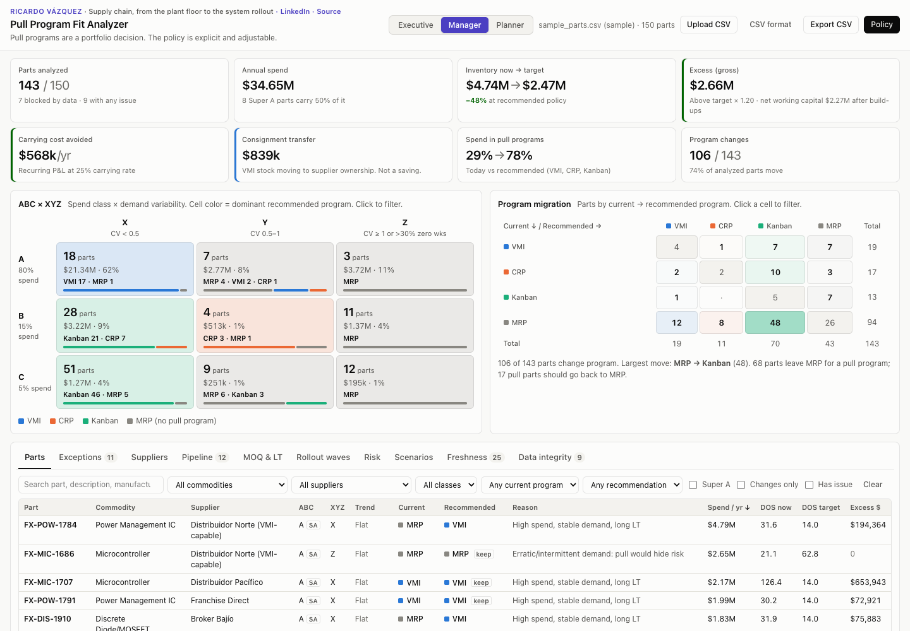
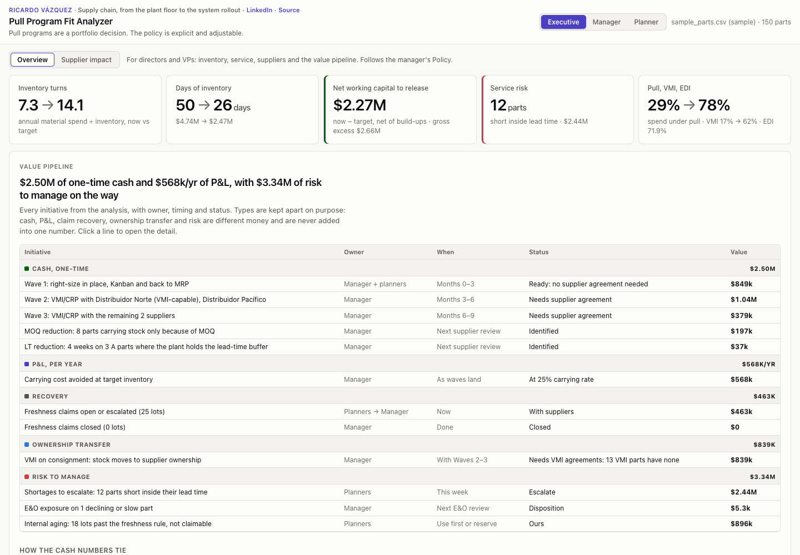
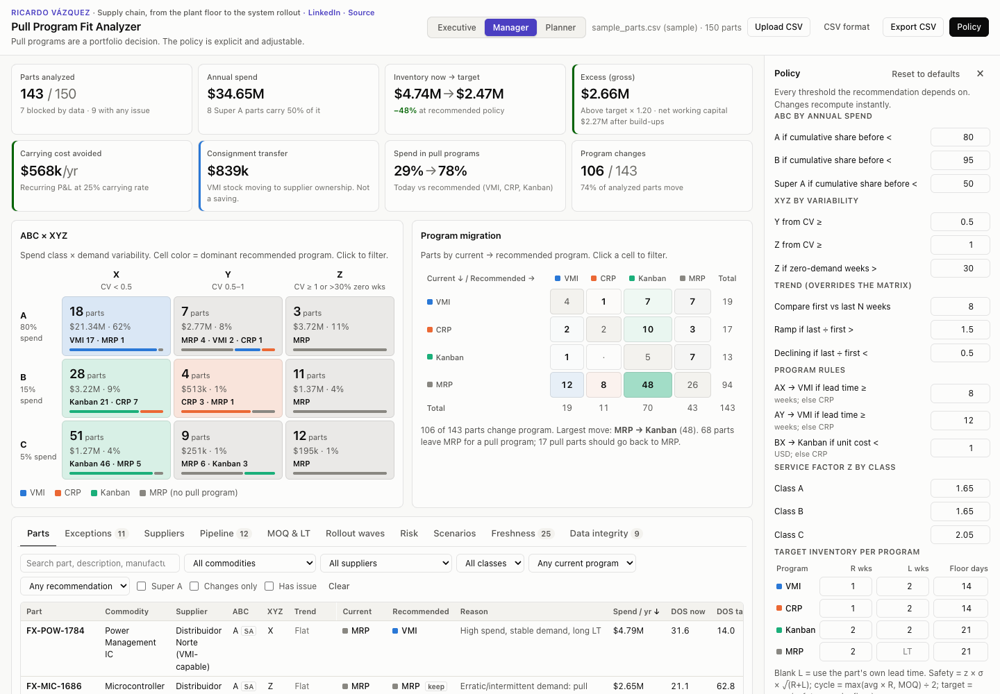
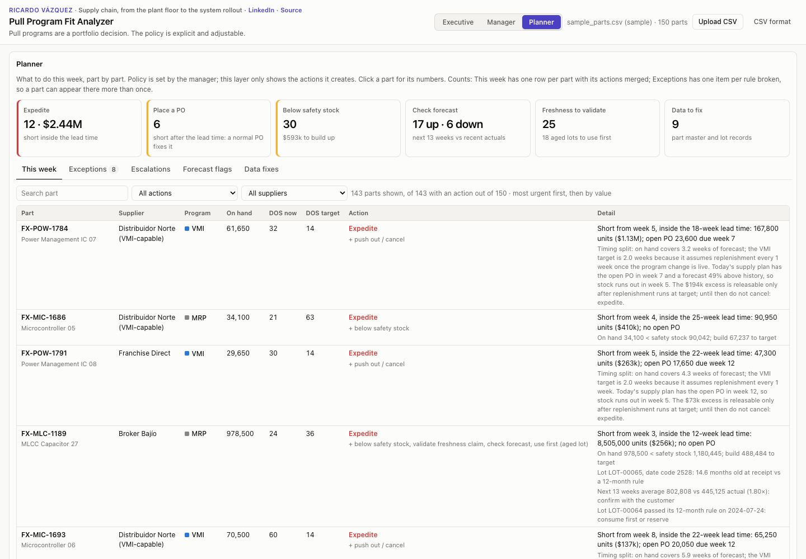

# Pull Program Fit Analyzer

[English](README.md) · **Español**

**Demo en vivo: [andreevazquez.github.io/pull-program-fit-analyzer/?lang=es](https://andreevazquez.github.io/pull-program-fit-analyzer/?lang=es)**

Los pull programs son una decisión de portafolio. Esta herramienta hace explícita y ajustable la política de compras.

[](https://andreevazquez.github.io/pull-program-fit-analyzer/?lang=es)

## Qué hace

**Problema.** En una planta EMS, cientos de componentes comprados se quedan en MRP por default. Con VMI, CRP o Kanban se llevarían con menos inventario y menos esfuerzo del planeador. Pasar una parte a un pull program se suele decidir una parte a la vez, en una junta, con reglas que nadie escribió.

**Enfoque.** El analizador toma 26 semanas de demanda por parte y clasifica todo el portafolio:
- ABC por gasto anual y XYZ por variabilidad de la demanda, con una revisión de tendencia.
- Una asignación de programa a partir de un conjunto explícito de reglas.
- Un inventario objetivo dimensionado por programa: safety stock, inventario de ciclo y un piso en días de inventario.

Cada umbral se edita en el panel de Política, y todo el análisis se recalcula en el navegador mientras escribes.

**Resultado.** Con la muestra de 150 partes:
- 106 partes cambian de programa, y el gasto bajo pull pasa de 29% a 78%.
- El inventario baja de $4.74 M a un objetivo de $2.47 M: de 7.3 a 14.1 de rotación.
- Eso libera **$2.27 M de capital de trabajo neto** y evita **$568 k al año** de carrying cost.
- $839 k de inventario VMI pasarían a ser propiedad del proveedor en consignación. Esa cifra se reporta aparte, porque una transferencia de propiedad no es un ahorro.

## Tres vistas, una política

El mismo análisis se muestra en tres niveles. El gerente es dueño de la política y las otras dos vistas la siguen.

### Director: dinero, servicio y el plan
Rotación y días de inventario, actual vs. objetivo. Además:
- **Capital de trabajo neto** a liberar y riesgo de servicio.
- **Penetración de pull, VMI y EDI.**
- **Pipeline de valor**: cada iniciativa con su responsable, tiempos y estatus. Efectivo, P&L, recuperación, transferencia de propiedad y riesgo se subtotalizan por separado y nunca se suman en un solo número. Una tabla muestra cómo se conectan el exceso, el capital de trabajo y el efectivo del pipeline.
- **Excepciones que necesitan a un director.**



### Gerente: segmentación y política
- **Matriz ABC × XYZ** y migración de programas.
- **Tabla de partes** con un panel paso a paso para cada recomendación.
- **Lista de negociación con proveedores** y scorecard.
- **Cobertura del pipeline**, proyectos de MOQ y lead time, olas de implementación, riesgo y escenarios.
- **Reclamos de frescura**, la bandeja de excepciones e integridad de datos.
- **Panel de Política**, donde se fija cada umbral.



### Planeador: qué hacer esta semana
Una fila por parte, ordenada por urgencia y luego por valor:
- **Acciones de abasto:** expeditar, colocar PO, abajo del safety stock, diferir exceso.
- **Revisiones:** revisar forecast, validar reclamo de frescura, usar primero el lote envejecido.
- **Datos:** corregir el maestro.

Cuando una parte está corta en el pipeline y en exceso al mismo tiempo, la línea de detalle explica la diferencia de tiempos, para que nadie cancele la orden que cubre el faltante.



## Simulación de retraso, borradores de propuesta y skill de Claude

Cuatro funciones toman como referencia los flujos de [Claude for Manufacturing](https://claude.com/resources/articles/claude-for-manufacturing): borradores que terminan en la revisión de una persona, cifras que se pueden rastrear hasta el dato, y una revisión inicial que dice qué todavía no puede correr.

- **Simulación de retraso de proveedor** (Gerente → Pipeline). Escoges un proveedor y un retraso: sus PO abiertas se recorren y la proyección de 13 semanas se recalcula. La vista muestra:
  - qué partes quedan cortas dentro de su lead time, donde una PO nueva ya no llega;
  - el valor adicional en riesgo y la primera semana corta;
  - qué expeditar o con quién buscar segunda fuente, y qué hay que ordenar antes.
  Con la muestra, Distribuidor Norte con cuatro semanas de retraso deja 39 partes cortas dentro de su lead time, con $317 k más en riesgo.
- **Borrador de propuesta VMI/CRP** (Gerente → Proveedores). Para un proveedor, las partes que la política pasa a VMI o CRP, con:
  - min (safety stock) y max (el min más un ciclo de revisión, o el MOQ) por parte;
  - lo que hay que pedirle según el scorecard: acuerdo VMI, EDI, consignación, reducción de lead time, plan de OTD, renovación del hub.
  El texto sale en EN/ES con la lista de partes en CSV. El estatus va de Borrador a Revisado a Enviado, y no se puede marcar Enviado sin haberlo marcado Revisado.
- **Revisión de datos** (el botón Datos r/n y el diálogo de formato CSV). Por archivo: si está cargado, cuántas filas coinciden con el archivo de partes y qué vistas alimenta.
- **Skill de Claude** ([descarga](https://andreevazquez.github.io/pull-program-fit-analyzer/downloads/pull-program-fit-skill.zip), código en [claude-skill/](claude-skill/pull-program-fit/SKILL.md)). El mismo motor como skill que Claude corre sobre una exportación del ERP: resultados, expeditados, simulación y propuesta en CSV, más un resumen que mantiene separados los tipos de valor. Lee tal cual los encabezados comunes de exportación (Item, Vendor, Qty On Hand, Standard Cost, Week 1…, lead time en días). Se sube a Claude como skill personalizada, en el mismo espacio de trabajo donde un equipo use Claude for Manufacturing o sus conectores de ERP.

Son funciones independientes inspiradas en ese lanzamiento, no una integración oficial.

## Cómo funciona la política

Reglas completas, fórmulas y ubicación en el código: **[docs/METHODOLOGY.es.md](docs/METHODOLOGY.es.md)**. Términos: **[docs/GLOSSARY.md](docs/GLOSSARY.md)**.

**1. Clasificar.**
- ABC por participación acumulada del gasto anual: A < 80%, B < 95%. Super A es < 50%.
- XYZ por coeficiente de variación: X < 0.5 ≤ Y < 1.0 ≤ Z. Una parte con más de 30% de semanas en cero también es Z.
- La tendencia compara las últimas 8 semanas con las primeras 8: Ramp-up arriba de 1.5×, En declive abajo de 0.5×.

**2. Asignar un programa.** Las partes en Ramp-up o En declive se quedan en MRP. Si no:

| | X (estable) | Y (moderada) | Z (errática) |
|---|---|---|---|
| **A** | VMI si LT ≥ 8 sem, si no CRP | VMI si LT ≥ 12 sem, si no CRP | MRP |
| **B** | Kanban si costo unitario < $1, si no CRP | CRP | MRP |
| **C** | Kanban | Kanban | MRP |

**3. Dimensionar el objetivo.**
- `safety = z × σ × √(R + L)`
- `cycle = max(avg × R, MOQ) / 2`
- `target = max(safety + cycle, piso en días de demanda)`
- Cada programa tiene su periodo de revisión R, exposición L y piso. En MRP la planta carga todo el lead time.

**4. Medir.**
- Días de inventario actual vs. objetivo.
- Exceso arriba del objetivo × 1.20.
- Transferencia por consignación para partes VMI.
- Carrying cost al 25% anual.

## Idiomas

La interfaz está en inglés y español (México). El idioma se elige así: `?lang=es` o `?lang=en` en la URL, luego la última elección guardada en este navegador, luego el idioma del navegador; inglés si no hay coincidencia. El botón EN | ES del encabezado cambia el idioma sin recargar.

El español es de negocios en México, y conserva en inglés los términos de supply chain que se usan así en planta (VMI, safety stock, lead time, forecast, PO, MOQ…). Ver el [glosario](docs/GLOSSARY.md). Números y moneda usan `Intl` con es-MX. Las exportaciones CSV y los nombres de columna siguen en inglés para que funcionen en cualquier configuración.

## Formato de entrada

Una fila por parte comprada. Al abrir se carga una muestra de 150 partes; puedes subir tu propio CSV con el mismo formato (máximo 10 MB, solo `.csv`).

| Columna | Tipo | Notas |
|---|---|---|
| `part_number` | texto | Único; los duplicados se marcan |
| `description` | texto | |
| `commodity` | texto | Se usa en los filtros |
| `manufacturer` | texto | |
| `supplier` | texto | Agrupa la lista de negociación y las olas de implementación |
| `unit_cost_usd` | número | Acepta `$` y separadores de miles; ≤ 0 o vacío bloquea la parte |
| `lead_time_weeks` | número | Vacío bloquea la parte |
| `moq` | número | Un MOQ mayor a 8 semanas de demanda se marca |
| `current_program` | texto | MRP, VMI, CRP o Kanban (mayúsculas o minúsculas; `VMI/SMI` se lee como VMI) |
| `on_hand_qty` | número | Unidades en existencia hoy |
| `w01` … `w26` | número | Demanda semanal en unidades, de la más antigua a la más reciente |

Archivos opcionales, que también se pueden reemplazar subiéndolos:

| Archivo | Contenido |
|---|---|
| `data/forecast.csv` | 13 semanas de forecast y la PO abierta |
| `data/suppliers.csv` | Maestro de proveedores: EDI, acuerdo VMI, hub, OTD, regla de frescura |
| `data/inventory_lots.csv` | Lotes con date code |
| `data/supply_events.csv` | EOL, PCN, asignación, aranceles y otros eventos de abasto |

Especificaciones: [docs/specs](docs/specs).

## Correr localmente

Sin build y sin dependencias que instalar. Sirve la carpeta por HTTP, porque los módulos ES no cargan desde `file://`:

```bash
python3 -m http.server 8000
```

Abre http://localhost:8000. Para correr las pruebas (Node 18 o posterior; `test/browser.mjs` además necesita Chrome o Chromium):

```bash
for t in test/*.mjs; do [ "$t" = test/csv.mjs ] || node "$t" || break; done
```

Las pruebas están descritas en el [README en inglés](README.md#run-locally). GitHub Actions las corre en cada push.

## Seguridad

- Todo valor de un CSV subido se trata como entrada no confiable y se escapa antes de mostrarse; `test/browser.mjs` sube archivos con `<script>` y HTML en cada campo de texto y revisa que nada se convierta en DOM.
- Subidas: solo `.csv`, máximo 10 MB; archivos vacíos, binarios o con columnas faltantes dan un mensaje claro.
- Content-Security-Policy, `X-Content-Type-Options: nosniff`, `Referrer-Policy` y `Permissions-Policy` en `_headers` (Cloudflare) y una CSP en `<meta>` para GitHub Pages. Las librerías de CDN llevan versión fija y Subresource Integrity.

## Datos y privacidad

**Datos sintéticos.** Los números de parte, fabricantes y proveedores son ficticios.

Todo corre en tu navegador. Un archivo subido nunca sale de la página y nada se guarda al cerrar la pestaña (solo la preferencia de idioma). La única otra solicitud es Cloudflare Web Analytics, que cuenta visitas anónimas sin cookies y nunca ve tus datos.

## Autor

**Ricardo Vázquez**: supply chain, del piso de planta a la implementación del sistema.
[LinkedIn](https://www.linkedin.com/in/ricardovazquez88)

Publicado bajo la [licencia MIT](LICENSE).
