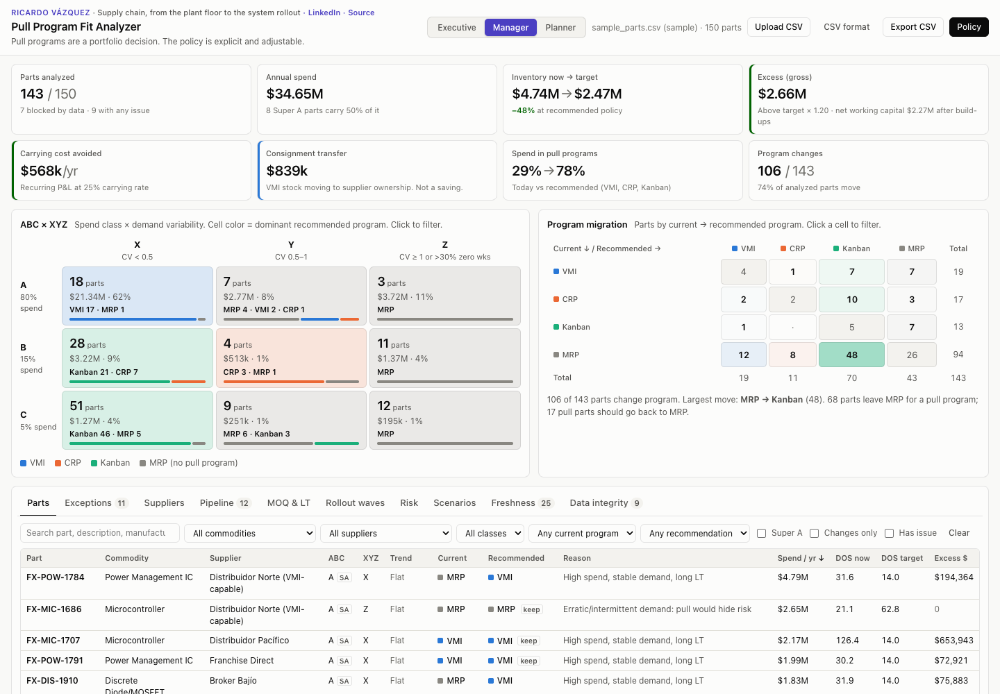
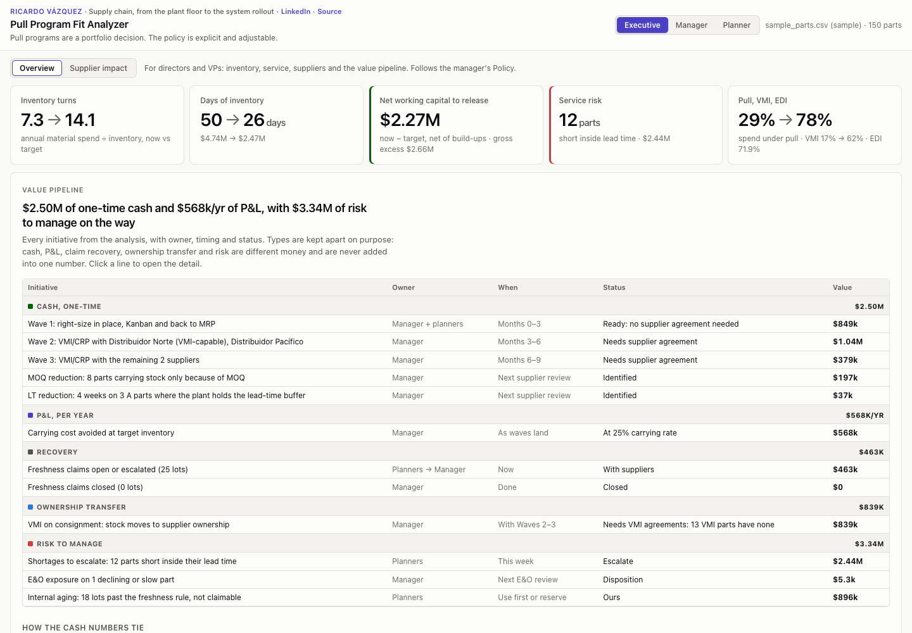
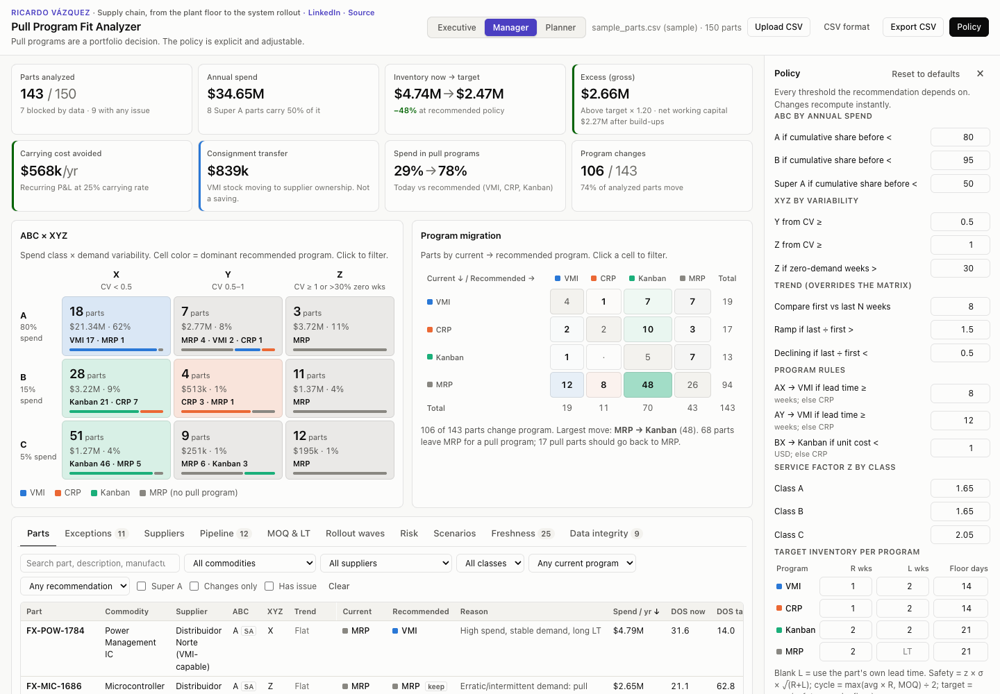
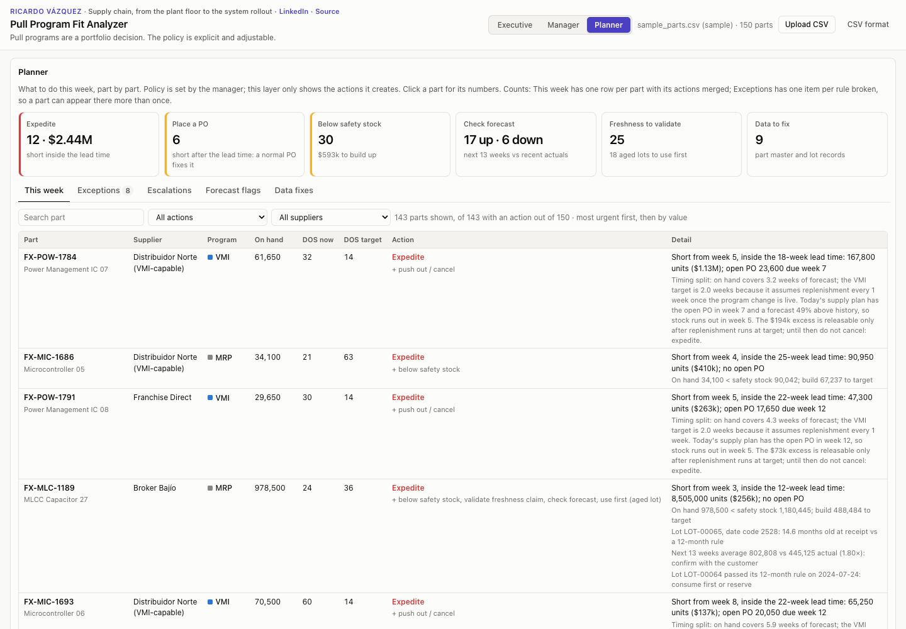

# Pull Program Fit Analyzer

**Live demo: [andreevazquez.github.io/pull-program-fit-analyzer](https://andreevazquez.github.io/pull-program-fit-analyzer/)**

Pull programs are a portfolio decision. This tool makes the purchasing policy explicit and adjustable.

[](https://andreevazquez.github.io/pull-program-fit-analyzer/)

## What it does

**Problem.** In an EMS plant, hundreds of purchased components sit in MRP by default. VMI, CRP or Kanban would carry them with less inventory and less planner effort. Moving a part to a pull program is usually decided one part at a time, in a meeting, with rules nobody wrote down.

**Approach.** The analyzer takes 26 weeks of demand per part and classifies the whole portfolio:
- ABC by annual spend and XYZ by demand variability, with a trend check.
- A program assignment from an explicit rule set.
- A target inventory sized per program: safety stock, cycle stock and a days-of-supply floor.

Every threshold is editable in a Policy panel, and the whole analysis recomputes in the browser as you type.

**Outcome.** On the 150-part sample:
- 106 parts change program, and spend under pull goes from 29% to 78%.
- Inventory goes from $4.74M to a $2.47M target, which is 7.3 to 14.1 turns.
- That releases **$2.27M of net working capital** and avoids **$568k a year** of carrying cost.
- $839k of VMI stock would move to supplier ownership on consignment. That figure is reported separately, because an ownership transfer is not a saving.

## Three views, one policy

The same analysis is shown at three levels. The manager owns the policy, and the other two views follow it.

### Executive: money, service and the plan
Turns and days of inventory, now vs. target. Also:
- **Net working capital** to release, and service risk.
- **Pull, VMI and EDI penetration.**
- **Value pipeline**: every initiative with its owner, timing and status. Cash, P&L, recovery, ownership transfer and risk are subtotaled separately and never added into one number. A cash bridge shows how excess, working capital and pipeline cash tie together.
- **Exceptions that need a director.**



### Manager: segmentation and policy
- **ABC × XYZ matrix** and program migration.
- **Parts table** with a step-by-step drawer for each recommendation.
- **Supplier negotiation list** and scorecard.
- **Pipeline coverage**, MOQ and lead-time projects, rollout waves, risk and scenarios.
- **Freshness claims**, the exceptions inbox and data integrity.
- **Policy panel**, where every threshold is set.



### Planner: what to do this week
One row per part, ordered by urgency and then value:
- **Supply actions:** expedite, place PO, below safety stock, push out excess.
- **Checks:** check forecast, validate freshness claim, use aged lot first.
- **Data:** fix master data.

When a part is short in the pipeline and in excess at the same time, the detail line explains the timing split, so nobody cancels the order that covers the shortage.



## How the policy works

Full rules, formulas and code locations: **[docs/METHODOLOGY.md](docs/METHODOLOGY.md)**.

**1. Classify.**
- ABC by cumulative share of annual spend: A < 80%, B < 95%. Super A is < 50%.
- XYZ by coefficient of variation: X < 0.5 ≤ Y < 1.0 ≤ Z. A part with more than 30% zero weeks is also Z.
- Trend compares the last 8 weeks with the first 8: Ramp above 1.5×, Declining below 0.5×.

**2. Assign a program.** Ramp or Declining parts stay in MRP. Otherwise:

| | X (stable) | Y (moderate) | Z (erratic) |
|---|---|---|---|
| **A** | VMI if LT ≥ 8 wks, else CRP | VMI if LT ≥ 12 wks, else CRP | MRP |
| **B** | Kanban if unit cost < $1, else CRP | CRP | MRP |
| **C** | Kanban | Kanban | MRP |

**3. Size the target.**
- `safety = z × σ × √(R + L)`
- `cycle = max(avg × R, MOQ) / 2`
- `target = max(safety + cycle, floor days of demand)`
- Each program has its own review period R, exposure L and floor. Under MRP the plant carries the full lead time.

**4. Measure.**
- Days of supply now vs. target.
- Excess above target × 1.20.
- Consignment transfer for VMI parts.
- Carrying cost at 25% a year.

## Input format

One row per purchased part. A 150-part sample loads on open; upload your own CSV in the same format.

| Column | Type | Notes |
|---|---|---|
| `part_number` | text | Unique; duplicates are flagged |
| `description` | text | |
| `commodity` | text | Used for filters |
| `manufacturer` | text | |
| `supplier` | text | Groups the negotiation list and rollout waves |
| `unit_cost_usd` | number | `$` and thousands separators are accepted; ≤ 0 or blank blocks the part |
| `lead_time_weeks` | number | Blank blocks the part |
| `moq` | number | MOQ above 8 weeks of demand is flagged |
| `current_program` | text | MRP, VMI, CRP or Kanban (any case; `VMI/SMI` reads as VMI) |
| `on_hand_qty` | number | Units on hand today |
| `w01` … `w26` | number | Weekly demand in units, oldest to newest |

Optional files, also replaceable by upload:

| File | Contents |
|---|---|
| `data/forecast.csv` | 13 weeks of forecast and the open PO |
| `data/suppliers.csv` | Supplier master: EDI, VMI agreement, hub, OTD, freshness rule |
| `data/inventory_lots.csv` | Lots with date codes |
| `data/supply_events.csv` | EOL, PCN, allocation, tariffs and other supply events |

Specs: [docs/specs](docs/specs).

## Run locally

No build step and no dependencies to install. Serve the folder over HTTP, because ES modules don't load from `file://`:

```bash
python3 -m http.server 8000
```

Then open http://localhost:8000. To run the tests (Node 18 or later):

```bash
for t in test/*.mjs; do [ "$t" = test/csv.mjs ] || node "$t" || break; done
```

| Test | Checks |
|---|---|
| `test/policy.mjs` | Unit tests for the policy engine: every classification and sizing rule at its boundaries |
| `test/check.mjs` | The JS reproduces `reference/expected_results.csv` from the Python reference (`reference/segment.py`) |
| `test/insights.mjs`, `test/v2.mjs` | Director views, pipeline coverage, scorecard, cash bridge |
| `test/freshness.mjs`, `test/exceptions.mjs`, `test/sales.mjs`, `test/robustness.mjs` | Freshness claims, exceptions inbox, sell-in identity, spreadsheet edge cases |

GitHub Actions runs all of them on every push. `node scripts/release.mjs` runs them, then bumps the cache-busting version before a deploy.

```
index.html, css/, js/     the app (plain ES modules; Papa Parse and Chart.js from cdnjs,
                          PptxGenJS from jsdelivr only when you download the deck)
data/                     sample data
docs/                     methodology, specs, screenshots
reference/                Python reference implementation and expected results
test/, scripts/           tests and the release script
```

## Data and privacy

**Synthetic data.** Part numbers, manufacturers and suppliers are fictional.

Everything runs in your browser. An uploaded file never leaves the page, and nothing is stored after the tab closes. The only other request is Cloudflare Web Analytics, which counts anonymous page views with no cookies and never sees your data.

## Author

**Ricardo Vázquez**: supply chain, from the plant floor to the system rollout.
[LinkedIn](https://www.linkedin.com/in/ricardovazquez88)

Released under the [MIT License](LICENSE).
